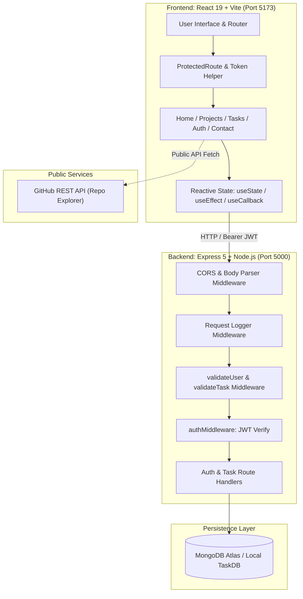

# 🎓 Student Portfolio & Full-Stack Task Manager

<div align="center">


**A high-performance full-stack web application combining a modern developer portfolio with a secure, production-grade MERN Task Management system.**

Developed for **Advanced Web Development Frameworks (AWDF)** &bull; Demonstrating **Practicals 1 through 7**

[Features](#-feature-matrix--practicals-breakdown) &bull;
[Architecture](#-system-architecture) &bull;
[API Specification](#-rest-api-specification) &bull;
[Getting Started](#-getting-started) &bull;
[Maturity Model](#-richardson-maturity-model-evaluation)

</div>

---

## 📖 Overview

This repository houses a comprehensive, multi-practical MERN application. It serves as both an interactive developer portfolio and a full-stack, authenticated Task Management dashboard. The project illustrates the progression of modern web development concepts: starting from component hierarchies and client-side routing, moving through async REST consumption, and culminating in full-stack CRUD operations backed by Express 5, MongoDB Atlas, bcrypt password hashing, and JWT authorization.

---

## 🏛️ System Architecture



---

## 🌟 Feature Matrix & Practicals Breakdown

### 🎯 Practical 1 & 2: Component Architecture & State Management
- **Modular Component Tree**: Clean separation of concerns with reusable `<Header />`, `<NavBar />`, `<About />`, `<Skills />`, and `<Footer />`.
- **Client-Side SPA Routing (`react-router-dom` v7)**: Instant page transitions without browser reloads:
  - `/` &bull; **Home**: Hero section, dynamic bio, and interactive skill tags.
  - `/projects` &bull; **Projects**: Dynamic repository explorer.
  - `/contact` &bull; **Contact**: Interactive controlled contact form.
  - `/auth` &bull; **Authentication Portal**: Unified Login and Registration.
  - `/tasks` &bull; **Task Manager**: Protected full-stack CRUD dashboard.
  - `*` &bull; **Custom 404 Route**: Graceful handling of undefined routes with quick return navigation.
- **Dynamic Theming (Light/Dark Mode)**: Global state toggle applying smooth CSS variable transitions across the entire UI.
- **Interactive Form State (`useState`)**:
  - Real-time controlled inputs with validation.
  - **Live Character Counter**: Dynamic message length indicator with visual threshold warnings (`warning` at 400 chars, `danger` at 450 chars of 500 limit).
  - **Help Tooltip Toggle**: Context-aware helper popover for form submission guidance.

---

### 🌐 Practical 3: REST API Integration & Async State
- **GitHub REST API Consumption**: Fetches public repositories in real-time from `https://api.github.com/users/{username}/repos` sorted by recent activity.
- **Three-State Async Flow**: Explicit handling of application states:
  - `loading` &bull; Triggers `<Spinner />` with smooth multi-ring animations.
  - `error` &bull; Renders `<ErrorMessage />` with human-readable error reasons and a **Retry** button.
  - `success` &bull; Renders `<RepoList />` with card grids displaying repo language, stars (`⭐`), and forks (`🍴`).
- **Live Search & Filter**: Real-time client-side repository filtering by name.
- **Resilient Execution**: Employs `useCallback` for stable re-fetch references and `.finally()` to guarantee loading state cleanup across all execution paths.

---

### ⚙️ Practical 4 & 5: Express Backend & MongoDB Integration
- **Express 5 REST API**: Strict RESTful architecture with structured status codes (`200`, `201`, `400`, `401`, `404`, `500`).
- **Middleware Pipeline**:
  - `cors`: Secure cross-origin resource sharing configured for `localhost:5173`.
  - `express.json()`: Body parsing with strict payload verification.
  - `logger`: Timestamped method and route tracking for every incoming request.
- **Mongoose Data Modeling & Validation**:
  - `Task` Schema: `title` (required, trimmed), `description` (trimmed), `completed` (boolean), `priority` (`low` | `medium` | `high`), and auto-timestamps.
  - `User` Schema: `email` (unique, lowercase, regex-validated), `password` (hashed string, min length 6), and creation timestamp.

---

### 📋 Practical 6: Full-Stack Task CRUD Operations
- **Full-Stack Connectivity**: Frontend `src/api.js` connects to backend routes via standard HTTP verbs (`GET`, `POST`, `PUT`, `DELETE`).
- **Interactive Task Dashboard (`/tasks`)**:
  - **Create & Edit**: Unified modal/form to author new tasks or update existing entries inline.
  - **Priority Indicators**: Visual color-coded badges (`🟢 low`, `🟡 medium`, `🔴 high`).
  - **Toggle Completion**: One-click status toggling directly updating the database.
  - **Confirmative Deletion**: Safety dialog preventing accidental task deletion.
  - **Feedback Notifications**: Floating `<Toast />` component displaying real-time feedback with automated timeout dismissal.

---

### 🔐 Practical 7: JWT Authentication & Defense-in-Depth Security
- **Bcrypt Password Encryption**: Industry-standard password hashing using `bcryptjs` with 10 salt rounds before database persistence.
- **JSON Web Token (JWT) Authorization**:
  - Stateless authentication tokens signed with `JWT_SECRET` and a 1-hour expiration lifespan.
  - Token payload encodes user identity (`id`, `email`).
- **Server-Side Auth Middleware (`authMiddleware`)**:
  - Intercepts requests, validates `Authorization: Bearer <token>` header.
  - Distinguishes between expired tokens (`TokenExpiredError`) and tampered/invalid tokens without crashing the server.
- **Server-Side Validation Middleware (`validateUser`, `validateTask`)**:
  - Defense-in-depth: Input validation executes *before* controller logic, guarding direct HTTP/Postman calls against malformed payloads.
- **Client-Side Protected Route Guard (`<ProtectedRoute />`)**:
  - Restricts `/tasks` to authenticated sessions.
  - Persistent token management via `localStorage`.
  - Automated 401 interception: redirects expired sessions back to `/auth` with clean token eviction.
- **User Profile Endpoint (`GET /me`)**: Returns current authenticated user metadata without re-exposing password hashes.

---

## 📁 Repository Structure

```text
AWDF/
├── New folder/                         # Backend REST API (Express + MongoDB)
│   ├── middleware/
│   │   ├── auth.js                     # JWT verification & token extraction
│   │   └── validate.js                 # Task & User request body validation
│   ├── models/
│   │   ├── Task.js                     # Mongoose schema for task documents
│   │   └── User.js                     # Mongoose schema with bcrypt hashing
│   ├── .env.example                    # Environment variable template
│   ├── package.json                    # Backend dependencies & scripts
│   └── server.js                       # Express server setup & API routes
│
├── New folder (2)/                     # API Architecture Evaluation
│   └── MATURITY.md                     # Richardson Maturity Model analysis
│
└── student-portfolio/                  # Frontend Application (React 19 + Vite)
    ├── public/                         # Static assets
    ├── src/
    │   ├── components/                 # Reusable UI components
    │   │   ├── About.jsx               # Bio and academic introduction
    │   │   ├── ErrorMessage.jsx        # Resilient error banner with retry
    │   │   ├── Footer.jsx              # Application footer with metadata
    │   │   ├── Header.jsx              # Hero header with developer title
    │   │   ├── NavBar.jsx              # Navigation links & theme switch
    │   │   ├── RepoList.jsx            # GitHub repository cards grid
    │   │   ├── Skills.jsx              # Categorized technical skills
    │   │   ├── Spinner.jsx             # CSS multi-ring loading spinner
    │   │   └── Toast.jsx               # Notification popups for CRUD
    │   ├── pages/                      # Page components
    │   │   ├── Auth.jsx                # Login / Register tabs with JWT handling
    │   │   ├── Contact.jsx             # Controlled form with live character count
    │   │   ├── Home.jsx                # Landing page combining About & Skills
    │   │   ├── NotFound.jsx            # Themed 404 error page
    │   │   ├── Projects.jsx            # GitHub API async repository explorer
    │   │   └── Tasks.jsx               # Full-stack task manager dashboard
    │   ├── api.js                      # Centralized API layer with Bearer injection
    │   ├── App.jsx                     # Route declarations & theme coordinator
    │   ├── index.css                   # Design tokens, variables & typography
    │   └── main.jsx                    # React 19 root mounting
    ├── index.html                      # HTML entry point
    ├── package.json                    # Frontend dependencies & scripts
    ├── README.md                       # Documentation (this file)
    └── vite.config.js                  # Vite configuration
```

---

## 🔌 REST API Specification

Base URL: `http://localhost:5000`

### 🔑 Authentication Endpoints (Public)

| Method | Endpoint | Description | Request Body | Success Response | Error Codes |
|:---|:---|:---|:---|:---|:---|
| `POST` | `/register` | Register a new user | `{ "email": "user@example.com", "password": "secretPassword" }` | `201 Created`<br>`{ "message": "User registered successfully" }` | `400` Validation<br>`409` Conflict |
| `POST` | `/login` | Authenticate user & issue JWT | `{ "email": "user@example.com", "password": "secretPassword" }` | `200 OK`<br>`{ "token": "<jwt_string>" }` | `400` Validation<br>`401` Unauthorized |

### 📋 Task Management Endpoints (Protected — Requires `Authorization: Bearer <token>`)

| Method | Endpoint | Description | Request Body | Success Response | Error Codes |
|:---|:---|:---|:---|:---|:---|
| `GET` | `/me` | Get logged-in user profile | *None* | `200 OK`<br>`{ "_id": "...", "email": "..." }` | `401`, `404` |
| `GET` | `/tasks` | Retrieve all tasks | *None* | `200 OK`<br>`[ { "_id": "...", "title": "...", "priority": "high", "completed": false } ]` | `401`, `500` |
| `GET` | `/tasks/:id` | Retrieve single task by ID | *None* | `200 OK`<br>`{ "_id": "...", "title": "...", ... }` | `401`, `404` |
| `POST` | `/tasks` | Create a new task | `{ "title": "string", "description": "string", "priority": "low"\|"medium"\|"high", "completed": false }` | `201 Created`<br>`{ "_id": "...", "title": "...", ... }` | `400` Validation<br>`401` Unauthorized |
| `PUT` | `/tasks/:id` | Update task by ID | `{ "title": "string", "description": "string", "priority": "...", "completed": true }` | `200 OK`<br>`{ "_id": "...", "title": "...", ... }` | `400`, `401`, `404` |
| `DELETE` | `/tasks/:id` | Delete task by ID | *None* | `200 OK`<br>`{ "message": "Task deleted" }` | `401`, `404` |

---

## 🚀 Getting Started

Follow these steps to set up and run both the frontend and backend locally.

### Prerequisites
- [Node.js](https://nodejs.org/) (v18 or higher recommended; verified on Node v24)
- [npm](https://www.npmjs.com/) (v9+)
- A running MongoDB instance (Local MongoDB server or [MongoDB Atlas connection string](https://www.mongodb.com/cloud/atlas))

---

### Step 1: Backend Setup (`New folder/`)

1. Open a terminal and navigate to the backend directory:
   ```bash
   cd "New folder"
   ```

2. Install dependencies:
   ```bash
   npm install
   ```

3. Configure environment variables:
   Create a `.env` file in the `New folder` root (or copy from `.env.example`):
   ```env
   PORT=5000
   MONGO_URI=your_mongodb_connection_string
   JWT_SECRET=your_jwt_secret_key_here
   ```

4. Start the Express API server:
   ```bash
   node server.js
   ```
   > 📡 Server starts on **`http://localhost:5000`** with MongoDB connection confirmed.

---

### Step 2: Frontend Setup (`student-portfolio/`)

1. Open a separate terminal and navigate to the frontend directory:
   ```bash
   cd student-portfolio
   ```

2. Install dependencies:
   ```bash
   npm install
   ```

3. Launch the Vite development server:
   ```bash
   npm run dev
   ```
   > 💻 Client runs on **`http://localhost:5173`** (or `http://127.0.0.1:5173`).

4. Open `http://localhost:5173` in your browser.

---

### Step 3: Production Build & Linting

- **Type/Syntax Linting**:
  ```bash
  npm run lint
  ```
- **Production Bundle**:
  ```bash
  npm run build
  ```
- **Preview Production Build**:
  ```bash
  npm run preview
  ```

---

## 📊 Richardson Maturity Model Evaluation

As evaluated in `New folder (2)/MATURITY.md`, our REST API conforms to **Level 2** of the Richardson Maturity Model:

| Level | Criterion | Status | Implementation Evidence |
|:---|:---|:---:|:---|
| **Level 0 — Single URI** | The swamp of POX (single RPC endpoint) | 🚀 **Exceeded** | The API uses distinct endpoints rather than tunneling calls through a single URI. |
| **Level 1 — Resources** | Individual URIs per resource | ✅ **Satisfied** | Separate URIs for collection (`/tasks`) and individual instances (`/tasks/:id`). |
| **Level 2 — HTTP Verbs & Codes** | Semantically correct verbs & status codes | ✅ **Satisfied** | Uses `GET`, `POST`, `PUT`, `DELETE` appropriately with standard codes: `200`, `201`, `400`, `401`, `404`, `500`. |
| **Level 3 — HATEOAS** | Hypermedia as the engine of application state | 💡 **Awareness** | Hypermedia links format is documented; standard REST clients prefer Level 2 predictable contracts. |

---

## 🛡️ Security Best Practices Implemented

- **Password Hashing**: Plaintext passwords never enter the database; salted hashes are generated via `bcrypt.hash(password, 10)`.
- **JWT Expiration & Safe Validation**: Tokens expire after 1 hour, minimizing attack windows. Signature verification is safely wrapped in error handlers to prevent unhandled rejection crashes.
- **Defense-in-Depth Validation**: Client validation provides instant user feedback, while server-side `validateUser` and `validateTask` guarantee database integrity even against automated or spoofed HTTP calls.
- **Selective Projections**: User queries use `.select('-password')` to ensure credential hashes are excluded from responses.
- **Secure Token Storage & Expiry Handling**: JWT is stored in `localStorage` and automatically purged if the server returns a `401 Unauthorized` response.

---

## 👨‍💻 Author

- **Student**: Pruthvi
- **Student ID**: 24IT074
- **Course**: Advanced Web Development Frameworks (AWDF)
